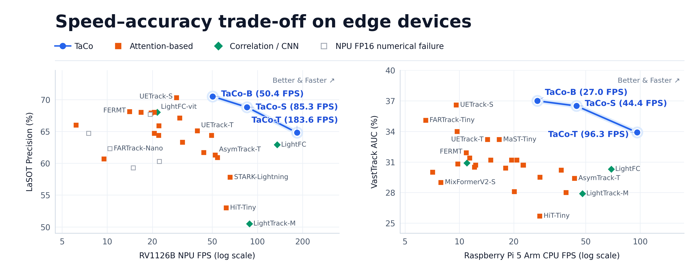
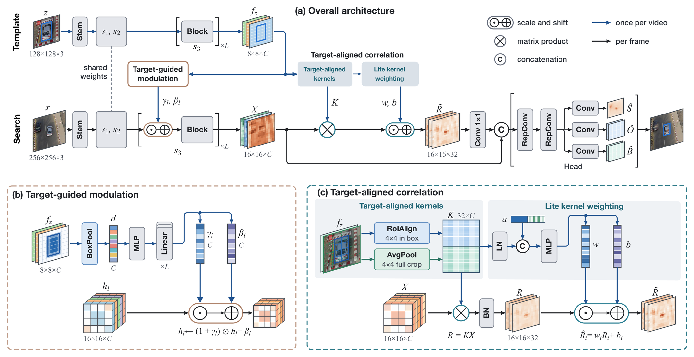
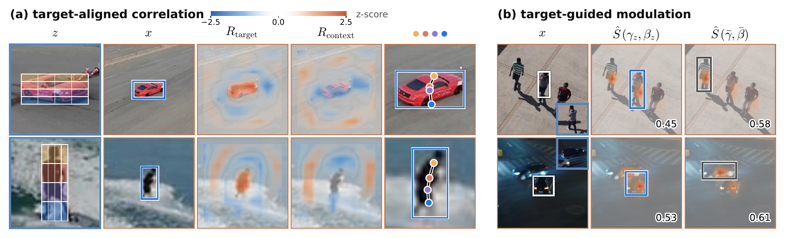

<div align="center">

# TaCo: Rethinking Correlation for Visual Tracking on Edge Devices

[](LICENSE)


[](weights/README.md)

[Model zoo](#taco-model-zoo) · [Predictions](#download-predictions) · [Quick start](#quick-start) · [Edge deployment](#7-edge-deployment-and-benchmarking)

</div>

## Highlights

- **TaCo-T** runs at **183.6 FPS** on the Rockchip RV1126B NPU and **96.3 FPS** on the Raspberry Pi 5 Arm CPU.
- **TaCo-B** reaches **65.6% LaSOT AUC**, **81.8% TrackingNet AUC**, and **37.0% VastTrack AUC** at **50.4 FPS** on the RV1126B NPU.
- **Zero per-frame attention.** All template operands are computed once per video and reused for every search frame.
- **Validated pure FP16 per-frame graphs** on both edge devices for all three variants, with zero CPU fallback in the RKNN search graph.



*LaSOT precision vs. RV1126B NPU FPS (left) and VastTrack AUC vs. Raspberry Pi 5 Arm CPU FPS (right). FPS measures per-frame graph execution with cached template operands.*

## Architecture overview



1. **Template stage, once per video.** The first-frame box defines the target crop. The shared CNN extracts a target descriptor and produces the channel-wise scales and shifts, box-aligned foreground and context kernels, and lite kernel weights. The tracker caches these operands.
2. **Search stage, once per frame.** Target-guided modulation applies the cached scales and shifts before each stage-3 block. Target-aligned correlation matches the search features to the cached weighted kernels in one matrix product. A RepConv center head predicts scores, offsets, and box sizes.

## Model zoo and benchmark results

### TaCo model zoo

| Model | Backbone | Mod. sites | Params (M) | GMACs/frame | LaSOT AUC / PN / P | GOT-10k AO / SR50 / SR75 | TrackingNet AUC / PN / P | VastTrack AUC / P | RV1126B ms / FPS | Pi 5 ms / FPS | Template ms (RV1126B / Pi 5) | Config | Weights |
| --- | ---: | ---: | ---: | ---: | ---: | ---: | ---: | ---: | ---: | ---: | ---: | ---: | ---: |
| TaCo-T | LowFormer-E1 | 4 | 5.53 | 1.49 | 62.3 / 70.8 / 64.8 | 66.3 / 76.2 / 60.9 | 78.8 / 83.3 / 75.3 | 33.9 / 29.9 | 5.45 / 183.6 | 10.38 / 96.3 | 19.41 / 5.45 | [T](configs/taco_t.yaml) | [Google Drive](https://drive.google.com/file/d/1ssVZSydXKStdm0BhkqFnXYZAoE0JfIyB/view?usp=drivesdk) |
| TaCo-S | RepViT-M1.1 | 13 | 6.74 | 1.69 | 64.5 / 73.3 / 68.8 | 67.0 / 76.2 / 63.1 | 81.0 / 85.5 / 78.5 | 36.5 / 34.0 | 11.72 / 85.3 | 22.52 / 44.4 | 24.31 / 7.27 | [S](configs/taco_s.yaml) | [Google Drive](https://drive.google.com/file/d/1ujRaXlVuCWvOUoV-zaMM8opKPOWI9UAH/view?usp=drivesdk) |
| TaCo-B | RepViT-M1.5 | 25 | 11.89 | 2.77 | 65.6 / 74.5 / 70.5 | 69.5 / 78.5 / 66.8 | 81.8 / 86.3 / 80.0 | 37.0 / 35.1 | 19.86 / 50.4 | 37.00 / 27.0 | 30.36 / 11.98 | [B](configs/taco_b.yaml) | [Google Drive](https://drive.google.com/file/d/105bSFs7RoP1z7DsPvT18uKwS2o3wlBDH/view?usp=drivesdk) |

Accuracy is in percent. PN is normalized precision, P is precision, and SR50/SR75 are success rates at IoU thresholds of 0.50/0.75. All TaCo scores use the epoch-300 mixed-training checkpoints and PyTorch CUDA FP16 autocast. LaSOT and VastTrack are scored locally. GOT-10k and TrackingNet scores come from their official test servers.

Parameter counts cover unique weights across both deployed graphs. Search graph timings use RKNN FP16 on the RV1126B NPU at 950 MHz and ncnn FP16 on four Cortex-A76 threads on the Pi 5. The separate RV1126B template measurement includes NPU FP16 backbone and kernel generation plus host box geometry and FP32 modulation parameters.

### Comparison with efficient trackers

**Bold** marks the highest displayed accuracy per metric. † denotes local reproduction without released checkpoints. ‡ marks an NPU timing that failed the numerical gate.

<details>
<summary>Full comparison on LaSOT, GOT-10k, TrackingNet and VastTrack</summary>

**Correlation / CNN fusion**

| Tracker | Pub | LaSOT AUC / PN / P | GOT-10k AO / SR50 / SR75 | TrackingNet AUC / PN / P | VastTrack AUC / P | GMACs/frame | NPU FPS | Arm FPS |
| --- | ---: | ---: | ---: | ---: | ---: | ---: | ---: | ---: |
| LightTrack-M | CVPR'21 | 50.8 / 57.4 / 50.5 | 50.5 / 58.5 / 32.3 | 71.4 / 77.9 / 68.6 | 27.9 / 24.4 | 0.51 | 88.5 | 47.9 |
| FEAR-XS | ECCV'22 | 50.1 / 59.4 / 52.3 | 57.5 / 68.3 / 45.7 | 71.5 / 80.6 / 70.0 | 29.6 / 25.9 | 0.46 | 258.5 | 91.6 |
| LightFC | KBS'24 | 60.3 / 69.8 / 62.9 | 64.9 / 75.8 / 57.1 | 77.1 / 83.2 / 74.2 | 30.3 / 27.5 | 0.95 | 135.4 | 69.2 |
| LightFC-vit | KBS'24 | 63.5 / 74.3 / 68.0 | 67.4 / 79.2 / 59.8 | 77.8 / 84.3 / 75.5 | 30.9 / 28.6 | 2.77 | 21.5 | 11.0 |

**Attention-based interaction**

| Tracker | Pub | LaSOT AUC / PN / P | GOT-10k AO / SR50 / SR75 | TrackingNet AUC / PN / P | VastTrack AUC / P | GMACs/frame | NPU FPS | Arm FPS |
| --- | ---: | ---: | ---: | ---: | ---: | ---: | ---: | ---: |
| STARK-Lightning | ICCV'21 | 58.1 / 66.5 / 57.8 | 59.9 / 69.9 / 48.3 | 72.7 / 77.9 / 67.4 | 28.0 / 23.3 | 1.54 | 65.8 | 38.9 |
| HCAT-R18 | ECCVW'22 | 59.3 / 68.7 / 60.9 | 65.3 / 76.7 / 56.9 | 76.6 / 82.6 / 72.9 | 29.5 / 26.0 | 2.96 | 54.1 | 27.9 |
| HiT-Tiny | ICCV'23 | 55.1 / 60.7 / 53.0 | 52.5 / 59.3 / 42.4 | 74.6 / 77.9 / 68.8 | 25.7 / 19.2 | 0.99 | 61.9 | 27.8 |
| HiT-Small | ICCV'23 | 61.1 / 68.7 / 61.7 | 62.5 / 71.2 / 54.3 | 77.8 / 81.8 / 73.2 | 28.1 / 22.8 | 1.13 | 43.9 | 20.1 |
| HiT-Base | ICCV'23 | 65.3 / 73.5 / 68.0 | 64.0 / 72.2 / 58.1 | 80.1 / 84.3 / 77.3 | 30.0 / 25.6 | 4.34 | 20.6 | 7.1 |
| Aba-ViTrack | ICCV'23 | 64.5 / 74.2 / 68.0 | 67.1 / 77.1 / 61.8 | 79.8 / 84.9 / 76.8 | 31.4 / 27.7 | 2.86 | 16.8 | 11.4 |
| MixFormerV2-S | NeurIPS'23 | 60.9 / 69.1 / 60.7 | 61.3 / 70.4 / 51.6 | 76.4 / 81.0 / 71.1 | 29.0 / 24.9 | 4.82 | 9.5 | 7.9 |
| SMAT | WACV'24 | 61.8 / 71.3 / 64.7 | 64.5 / 74.8 / 57.9 | 78.6 / 84.2 / 75.7 | 30.8 / 27.4 | 2.49 | 20.6 | 9.8 |
| AVTrack | ICML'24 | 61.7 / 71.0 / 64.4 | 64.6 / 74.7 / 57.8 | 78.5 / 83.6 / 74.9 | 30.5 / 27.0 | 2.39 | 22.0 | 12.1 |
| PromptVT | TCSVT'24 | 64.0 / 74.0 / 67.1 | 67.6 / 78.7 / 61.2 | 78.0 / 83.4 / 74.4 | 31.2 / 28.1 | 1.93 | 30.4 | 20.8 |
| FERMT† | ECCV'24 | 65.0 / 74.0 / 68.1 | 68.8 / 78.9 / 64.1 | 80.8 / 85.6 / 78.1 | 31.9 / 28.8 | 2.64 | 14.1 | 10.9 |
| AsymTrack-T | AAAI'25 | 61.0 / 68.8 / 61.3 | 62.4 / 71.5 / 54.8 | 76.2 / 80.9 / 71.6 | 29.4 / 24.6 | 0.64 | 52.4 | 43.3 |
| AsymTrack-S | AAAI'25 | 62.6 / 71.0 / 64.4 | 65.5 / 74.8 / 58.9 | 77.9 / 82.6 / 74.0 | 30.2 / 25.9 | 0.72 | 49.5 | 36.6 |
| AsymTrack-B | AAAI'25 | 64.7 / 73.1 / 67.9 | 67.7 / 76.6 / 61.5 | 79.9 / 84.4 / 77.3 | 31.2 / 27.3 | 1.77 | 19.6 | 14.9 |
| ORTrack | CVPR'25 | 62.9 / 72.6 / 65.9 | 65.4 / 75.3 / 58.8 | 79.2 / 84.3 / 75.9 | 30.7 / 27.2 | 2.85 | 22.1 | 12.3 |
| ORTrack-D | CVPR'25 | 61.3 / 70.1 / 63.3 | 63.3 / 73.2 / 56.3 | 78.4 / 83.5 / 74.6 | 30.7 / 26.9 | 1.77 | 31.7 | 22.5 |
| SGLATrack | CVPR'25 | 63.1 / 72.4 / 66.0 | 66.3 / 76.2 / 60.3 | 79.5 / 84.9 / 76.5 | 31.2 / 27.7 | 1.95 | 6.2 | 19.4 |
| FARTrack-Pico | ICLR'26 | 57.9 / 66.6 / 59.3 | 62.6 / 72.7 / 51.0 | 75.6 / 81.4 / 70.4 | 30.4 / 25.8 | 1.43 | 14.9‡ | 18.0 |
| FARTrack-Nano | ICLR'26 | 59.5 / 67.8 / 62.3 | 69.3 / 80.0 / 60.3 | 79.0 / 84.3 / 75.4 | 34.0 / 30.4 | 2.34 | 10.4‡ | 9.7 |
| FARTrack-Tiny | ICLR'26 | 61.7 / 69.8 / 64.7 | 70.2 / 80.6 / 64.1 | 80.3 / 85.3 / 77.2 | 35.1 / 32.3 | 3.47 | 7.5‡ | 6.5 |
| UETrack-T | CVPR'26 | 63.4 / 72.5 / 65.1 | 65.3 / 75.2 / 58.6 | 78.7 / 83.4 / 74.4 | 33.2 / 29.3 | 2.50 | 39.8 | 14.3 |
| UETrack-S | CVPR'26 | **66.5** / **75.7** / 70.3 | **71.1** / **81.3** / **66.9** | 81.4 / 85.9 / 78.6 | 36.6 / 33.7 | 3.54 | 28.9 | 9.6 |
| MaST-Nano | ECCV'26 | 59.2 / 68.7 / 60.3 | 61.6 / 72.0 / 53.8 | 77.2 / 82.9 / 72.9 | 30.7 / 26.3 | 0.68 | 22.2‡ | 22.6 |
| MaST-Tiny | ECCV'26 | 64.0 / 73.1 / 67.7 | 68.0 / 77.4 / 64.2 | 81.2 / 86.1 / 78.6 | 33.2 / 29.8 | 0.96 | 19.3‡ | 16.6 |

**Target-aligned correlation**

| Tracker | Pub | LaSOT AUC / PN / P | GOT-10k AO / SR50 / SR75 | TrackingNet AUC / PN / P | VastTrack AUC / P | GMACs/frame | NPU FPS | Arm FPS |
| --- | ---: | ---: | ---: | ---: | ---: | ---: | ---: | ---: |
| TaCo-T | Ours | 62.3 / 70.8 / 64.8 | 66.3 / 76.2 / 60.9 | 78.8 / 83.3 / 75.3 | 33.9 / 29.9 | 1.49 | 183.6 | 96.3 |
| TaCo-S | Ours | 64.5 / 73.3 / 68.8 | 67.0 / 76.2 / 63.1 | 81.0 / 85.5 / 78.5 | 36.5 / 34.0 | 1.69 | 85.3 | 44.4 |
| TaCo-B | Ours | 65.6 / 74.5 / **70.5** | 69.5 / 78.5 / 66.8 | **81.8** / **86.3** / **80.0** | **37.0** / **35.1** | 2.77 | 50.4 | 27.0 |

</details>

### Additional benchmarks

| Tracker | LaSOT ext AUC / P | TNL2K AUC / P | NfS AUC / P | UAV123 AUC / P |
| --- | ---: | ---: | ---: | ---: |
| LightFC | 41.4 / 45.4 | 49.6 / 48.1 | 63.7 / 76.7 | 64.7 / 85.1 |
| HiT-Tiny | 35.7 / 36.0 | 41.3 / 33.8 | 53.4 / 60.4 | 59.7 / 76.8 |
| MixFormerV2-S | 43.1 / 45.7 | 45.9 / 40.1 | 62.6 / 74.1 | 65.5 / 86.4 |
| SMAT | 40.7 / 43.9 | 50.9 / 48.7 | 63.4 / 75.8 | 64.8 / 84.7 |
| PromptVT | **45.3** / **49.4** | 51.1 / 49.2 | 64.9 / 78.2 | 66.6 / **87.5** |
| AsymTrack-T | 42.7 / 45.9 | 48.6 / 44.5 | 63.3 / 74.5 | 64.4 / 84.2 |
| ORTrack-D | 42.5 / 46.3 | 49.5 / 46.2 | 64.3 / 76.5 | 65.7 / 86.0 |
| FARTrack-Pico | 39.8 / 41.9 | 48.2 / 45.0 | 62.3 / 76.2 | 63.0 / 84.2 |
| UETrack-T | 42.1 / 46.2 | 45.9 / 40.8 | 63.5 / 75.9 | **66.9** / 86.2 |
| MaST-Nano | 41.1 / 43.3 | 47.2 / 42.3 | 61.9 / 72.8 | 62.4 / 81.0 |
| AVTrack | 42.5 / 46.6 | 49.4 / 46.5 | 63.5 / 75.1 | 66.1 / 86.4 |
| SGLATrack | 42.5 / 46.2 | 51.4 / 49.3 | 64.7 / 76.9 | 66.8 / 87.4 |
| TaCo-T | 41.3 / 45.4 | 50.8 / 48.5 | 65.7 / 78.7 | 64.3 / 83.5 |
| TaCo-S | 43.2 / 47.9 | 53.1 / 52.8 | 65.7 / 78.4 | 65.0 / 83.7 |
| TaCo-B | 44.5 / **49.4** | **54.0** / **54.5** | **66.4** / **79.6** | 64.8 / 83.9 |

<details>
<summary>GOT-10k-only training (one-shot protocol)</summary>

Official test scores use epoch-100 checkpoints trained solely on the GOT-10k training split. The TaCo rows use the Arm FPS from the same architectures in the main comparison. [Download one-shot weights](weights/README.md#got-10k-only-epoch-100) · [Download one-shot predictions](https://drive.google.com/file/d/13t_O0ruIi9WTiDfzeJLL-WFY9zQk53Br/view?usp=drivesdk)

| Tracker | Pub | AO | SR50 | SR75 | Arm FPS |
| --- | ---: | ---: | ---: | ---: | ---: |
| TransT | CVPR'21 | 67.1 | 76.8 | 60.9 | 0.8 |
| STARK-ST50 | ICCV'21 | 68.0 | 77.7 | 62.3 | 2.0 |
| OSTrack-256 | ECCV'22 | 71.0 | 80.4 | 68.2 | 1.7 |
| LiteTrack-B4 | ICRA'24 | 65.2 | 74.7 | 57.7 | 6.5 |
| FERMT | ECCV'24 | 69.6 | 80.1 | 63.2 | 10.9 |
| MST | MM'25 | 69.6 | 79.8 | 64.1 | 3.6 |
| TaCo-T | Ours | 61.8 | 70.9 | 54.5 | 96.3 |
| TaCo-S | Ours | 65.6 | 75.1 | 61.1 | 44.4 |
| TaCo-B | Ours | 66.7 | 76.5 | 62.4 | 27.0 |

To reproduce the GOT-10k-only 100-epoch training (using `configs/taco_{t,s,b}.yaml` and all 9,335 training sequences):

```bash
torchrun --standalone --nproc_per_node=4 train.py --config configs/taco_t.yaml \
  --data-root ./data --datasets GOT10K_train_full --epochs 100 --lr-drop-epoch 80 \
  --save-dir outputs/taco_t_got10k_only
```

</details>

### Download predictions

Each archive contains predictions for TaCo-T, TaCo-S, and TaCo-B. The GOT-10k one-shot predictions use the epoch-100 GOT-10k-only checkpoints. The other archives use the mixed-training epoch-300 checkpoints. [Browse all release files on Google Drive](https://drive.google.com/drive/folders/11OYjuKN3YOtA5rp8WfL5AH9DIi4d7Tz7)

| Benchmark | Google Drive |
| --- | --- |
| LaSOT test | [ZIP](https://drive.google.com/file/d/1j4aLOZ5ePbtvbgkyRAVytGZGE8kdDqXF/view?usp=drivesdk) |
| GOT-10k test (mixed training) | [ZIP](https://drive.google.com/file/d/1v8LPcLxbHgw3jbnfIvOxMtep91Ipx6kC/view?usp=drivesdk) |
| TrackingNet test | [ZIP](https://drive.google.com/file/d/1Bzgq1XeZFcanY3pC1g2nbwX1K2t3dN6Y/view?usp=drivesdk) |
| VastTrack test | [ZIP](https://drive.google.com/file/d/1EAoYsU285MSHmvr-gRTU3gGpJOF83PLN/view?usp=drivesdk) |
| LaSOT extension | [ZIP](https://drive.google.com/file/d/13RbVLOVhSkWrxoXIIWPusEmPFzve16zg/view?usp=drivesdk) |
| TNL2K test | [ZIP](https://drive.google.com/file/d/1Q-8BZEmI_T4V5HLp7kqSDY68Pb4H1nCR/view?usp=drivesdk) |
| NfS (30 FPS) | [ZIP](https://drive.google.com/file/d/1W2rpj8ix6INprfKJt9ZG-z45EJyS5ddI/view?usp=drivesdk) |
| UAV123 | [ZIP](https://drive.google.com/file/d/1fFZmVhXtInPiCda8nGkvnd2QySF0hFdd/view?usp=drivesdk) |
| DTB70 | [ZIP](https://drive.google.com/file/d/1qbg2SFmdDw_9PRkT4uk4WpggwoRxtQYx/view?usp=drivesdk) |
| UAVDT | [ZIP](https://drive.google.com/file/d/1YKVbdCqq94ItUnOqU72gFFqxr8jLdhFl/view?usp=drivesdk) |
| VisDrone2018-SOT | [ZIP](https://drive.google.com/file/d/15TPZlLPWCRE1EfEhDrSyPZfCLdK_S5yR/view?usp=drivesdk) |
| UAVDark135 | [ZIP](https://drive.google.com/file/d/1loe7AC1nxDRiv5Q8QM97MgRg-vaVY744/view?usp=drivesdk) |
| GOT-10k validation | [ZIP](https://drive.google.com/file/d/1bNSDEjVbqqvdebbhYkQ7tVC9IZUeTh9_/view?usp=drivesdk) |
| GOT-10k test (one-shot) | [ZIP](https://drive.google.com/file/d/13t_O0ruIi9WTiDfzeJLL-WFY9zQk53Br/view?usp=drivesdk) |

Extract archives for locally scored benchmarks into `results/` to restore the model and dataset directory layout. The GOT-10k test and TrackingNet test archives contain the original submission ZIP for each model.

## Mechanism visualization



*Target kernels respond inside the object while context kernels respond around it. Replacing the instance-specific modulation with its cross-video mean can move the score peak onto a distractor.*

## Quick start

Clone the release repository and run the commands below from its root.

### 1. Installation

For training, PyTorch inference, and ONNX export, create a Python environment and install the full dependencies.

```bash
python -m venv .venv
source .venv/bin/activate
python -m pip install -r requirements_train.txt
```

Install matching `torch` and `torchvision` builds from the same PyTorch CPU or CUDA wheel index. The template stage uses `torchvision::roi_align`. If the CUDA kernel is unavailable, PyTorch tracking can run this once-per-video operation on CPU. ONNX export for edge conversion requires torchvision so the export contains a standard `RoiAlign` node. [PyTorch installation](https://pytorch.org/get-started/locally/)

For CPU inference with pre-exported ONNX graphs, use the minimal dependencies in a separate environment.

```bash
python -m pip install -r requirements.txt
```

ONNX Runtime inference uses NumPy and OpenCV preprocessing and reads both graphs from `onnx_models/<model>/`. For CUDA inference, install `onnxruntime-gpu` in place of the CPU `onnxruntime` package and select `--device cuda`.

### 2. Dataset preparation

Place datasets under `./data` (or set `export TACO_DATA_ROOT=/path/to/datasets`).

**Training only requires 4 datasets:** **LaSOT**, **GOT-10k**, **COCO 2017**, and **VastTrack**. You do **not** need any other dataset to train TaCo-T, TaCo-S, or TaCo-B with the paper recipe (`configs/taco_{t,s,b}.yaml`).

```text
data/
├── lasot/                                  # [Train + Eval] LaSOT
│   └── <class>/<sequence>/
│       ├── img/00000001.jpg
│       ├── groundtruth.txt
│       ├── full_occlusion.txt
│       └── out_of_view.txt
├── got10k/                                 # [Train] GOT-10k (train/ required for training)
│   └── train/
│       ├── list.txt
│       └── <sequence>/                     # numbered JPGs, groundtruth.txt,
│                                           # absence.label, cover.label, meta_info.ini
├── coco/                                   # [Train] COCO 2017
│   ├── images/train2017/
│   └── annotations/instances_train2017.json
└── vasttrack/                              # [Train] VastTrack training split
    └── <class>/<sequence>/
        ├── imgs/00001.jpg
        └── Groundtruth.txt
```

Verify your environment and the 4 training datasets before launching training:

```bash
python scripts/check_env.py --data-root ./data
```

<details>
<summary>Optional evaluation-only benchmarks (not required for training)</summary>

Add any of the following under `data/` only if you want to evaluate on additional test benchmarks with `eval.py` / `metrics.py`:

```text
data/
├── got10k/
│   ├── val/{list.txt,<sequence>/}          # --dataset got10k_val
│   └── test/{list.txt,<sequence>/}         # --dataset got10k_test (official server)
├── lasot_extension_subset/                 # --dataset lasot_extension_subset (same layout as lasot/)
│   └── <class>/<sequence>/
├── trackingnet/TEST/                       # --dataset trackingnet (official server)
│   ├── anno/<sequence>.txt
│   └── frames/<sequence>/0.jpg
├── vasttrack_test/                         # --dataset vasttrack_test
│   └── <class>/<sequence>/
│       ├── imgs/00001.jpg
│       └── Groundtruth.txt
├── uav123/                                 # --dataset uav
│   ├── data_seq/UAV123/<sequence>/
│   └── anno/UAV123/<sequence>.txt
├── uavdt/                                  # --dataset uavdt
│   ├── sequences/<sequence>/
│   └── anno/<sequence>_gt.txt
├── dtb70/<sequence>/                       # --dataset dtb70
│   ├── img/
│   └── groundtruth_rect.txt
├── nfs/<sequence>/240/                     # --dataset nfs / nfs_30
│   ├── <sequence>/
│   └── <sequence>.txt
├── tnl2k/<sequence>/                       # --dataset tnl2k (or tnl2k/test/<sequence>/)
│   ├── imgs/
│   └── groundtruth.txt
├── visdrone2018/                           # --dataset visdrone2018
│   ├── sequences/<sequence>/
│   └── annotations/<sequence>.txt
└── uavdark135/                             # --dataset uavdark135
    ├── Sequences/<sequence>/
    └── anno_revise/<sequence>.txt
```

For `eval.py` and `metrics.py`, `--data-root` points to an individual benchmark directory (for example `./data/lasot` or `./data/got10k`).

</details>

### 3. Pretrained ImageNet backbones

Download the checkpoint for your variant into `pretrained_models/`. Re-run the environment check after placing the checkpoint. [Download links and SHA-256 checksums](pretrained_models/README.md)

| Variant | Backbone checkpoint |
| --- | --- |
| TaCo-T | `pretrained_models/lowformer_E1.pt` |
| TaCo-S | `pretrained_models/repvit_m1_1_distill_300e.pth` |
| TaCo-B | `pretrained_models/repvit_m1_5_distill_300e.pth` |

### 4. Training

The paper recipe trains for 300 epochs on four V100 GPUs, with 32 pairs per GPU (128 total) and 60,000 pairs per epoch sampled equally from the four training datasets. AdamW starts at 0.00008 for the backbone and 0.0008 for the remaining parameters. Both rates drop by a factor of ten at epoch 240. Each variant uses a 128 × 128 template crop and a 256 × 256 search crop.

```bash
# Four-GPU DDP. Run the script for your preferred variant.
bash scripts/train_taco_t.sh --data-root ./data
bash scripts/train_taco_s.sh --data-root ./data
bash scripts/train_taco_b.sh --data-root ./data

# Equivalent direct launcher for TaCo-T.
torchrun --standalone --nproc_per_node=4 train.py --config configs/taco_t.yaml --data-root ./data

# Single GPU with the PyTorch DataLoader.
CUDA_VISIBLE_DEVICES=0 python train.py --config configs/taco_t.yaml \
  --data-root ./data --pipeline torch

# Resume the latest full checkpoint in the same run directory.
bash scripts/train_taco_t.sh --data-root ./data --save-dir outputs/taco_t --resume auto
```

Use `--batch-size` to adjust the **per-GPU** batch size. `--pipeline auto` selects DALI when available on CUDA and otherwise uses the PyTorch DataLoader. To require DALI, install `nvidia-dali-cuda120` in a compatible CUDA environment and pass `--pipeline dali`. `jpeg4py` is optional for image decoding.

Run a short single-GPU smoke test using the GOT-10k training data and a separate output directory.

```bash
CUDA_VISIBLE_DEVICES=0 python train.py --config configs/taco_t.yaml \
  --data-root ./data --pipeline torch --datasets GOT10K_vottrain --pretrained none \
  --epochs 1 --batch-size 2 --samples-per-epoch 8 --num-workers 0 \
  --save-dir outputs/smoke_taco_t
```

### 5. Evaluation and metrics

Place a released checkpoint in `weights/` or point `--weights` to the matching checkpoint produced by training. [Trained weight filenames and checksums](weights/README.md)

```bash
# PyTorch CUDA with FP16 autocast, as used for the paper's TaCo accuracy.
python eval.py TaCo-T --dataset lasot --backend pytorch --device cuda --fp16 \
  --weights weights/TaCo-T.pth --data-root ./data/lasot

# ONNX Runtime CPU after exporting both graphs in step 7.
python eval.py TaCo-T --dataset lasot --backend onnx --device cpu \
  --data-root ./data/lasot --results-dir results/onnx/TaCo-T/lasot

# Score PyTorch predictions on a locally annotated benchmark.
python metrics.py TaCo-T --dataset lasot --data-root ./data/lasot
python metrics.py --all

# Package predictions for GOT-10k test or TrackingNet test official server submission.
python eval.py TaCo-T --dataset got10k_test --backend pytorch --device cuda --fp16 \
  --data-root ./data/got10k --pack-zip
python eval.py TaCo-T --dataset trackingnet --backend pytorch --device cuda --fp16 \
  --data-root ./data/trackingnet --pack-zip
```

Passing a custom `--weights` path (other than the default `weights/<model>.pth`) writes predictions into a checkpoint-hashed subdirectory under `results/<model>/` to avoid overwriting released results; pass the printed output path to `metrics.py --results-dir` when scoring a custom checkpoint. `metrics.py --all` uses the configured dataset roots and the default results directory. For GOT-10k test and TrackingNet test, `--pack-zip` generates `<model>_<dataset>_submission.zip` in the server-required format (`<seq>/<seq>_001.txt` + `<seq>_time.txt` for GOT-10k; comma-separated `<seq>.txt` for TrackingNet).

### 6. Video or image-folder demo

Pass the first-frame bounding box in pixels as `x,y,width,height`, with `x,y` at the top-left corner. Use a video file or a directory of frames sorted by filename.

```bash
python demo_video.py TaCo-T --input video.mp4 --init-bbox 120,80,96,64 \
  --backend pytorch --weights weights/TaCo-T.pth --output tracked.mp4

python demo_video.py TaCo-T --input ./frames --init-bbox 120,80,96,64 \
  --backend onnx --device cpu --output tracked_frames.mp4
```

### 7. Edge deployment and benchmarking

See [deploy/README.md](deploy/README.md) for the full deployment guide and real-video tracking results on Raspberry Pi 5 and Rockchip RV1126B.

**Export ONNX first.** With the full dependencies installed, export the template and search graphs. The exporter applies deploy-time reparameterization and compares the ONNX Runtime FP32 chain against PyTorch FP32 (relative L2 ≤ 10⁻⁴, identical score peak, and box error ≤ 10⁻⁵).

```bash
python deploy/export_onnx.py --model TaCo-T --weights weights/TaCo-T.pth
```

**Raspberry Pi 5.** Install `pnnx` and Python `ncnn` on the conversion host. The exporter lowers template RoIAlign to a matrix product using host-computed box geometry. On the Pi 5, install Python `ncnn`, `numpy`, and `opencv-python` (for video demo), and copy `build/ncnn/TaCo-<variant>/`, `deploy/`, `benchmark/`, and `tracker.py`. Run the conversion on the host and the video demo or benchmarks on the Pi 5.

```bash
# On conversion host: export both lowered template and search graphs to ncnn
python deploy/export_ncnn.py --model TaCo-T --out build/ncnn/TaCo-T --graph both --check-fp16

# On Raspberry Pi 5: video / frame-folder / camera tracking (zero PyTorch or ONNX Runtime)
python deploy/pi5_demo_video.py --model-dir build/ncnn/TaCo-T \
  --input sample.mp4 --init-bbox 120,80,96,64 \
  --output tracked_pi5.mp4 --threads 4 --setting winograd_f23

# On Raspberry Pi 5: latency & numerical verification benchmarks
python benchmark/pi5_benchmark.py --model-dir build/ncnn/TaCo-T/search \
  --graph search --threads 4 --screen --out results/pi5_t_search.json
python benchmark/pi5_benchmark.py --model-dir build/ncnn/TaCo-T/template \
  --graph template --threads 4 --out results/pi5_t_template.json
```

**Rockchip RV1126B.** Install RKNN Toolkit2 v2.3.2 on an x86-64 Linux conversion host. On the board, install RKNN Runtime v2.3.2 (`/usr/lib/librknnrt.so`), `numpy`, and `opencv-python` (for video demo). Copy the build directory, `deploy/`, `benchmark/`, and `tracker.py` to the board. For the paper's search timing, pass Rockchip's v2.3.2 `rknn_benchmark` binary compiled for AArch64. The benchmark can also call `rknn_run` through ctypes when `--cbench` is omitted.

```bash
# On x86-64 Linux host: export hybrid template and FP16 search RKNN graphs
python deploy/export_rknn.py --model TaCo-T --out build/rknn/TaCo-T --graph both --verify-sim

# On RV1126B: NPU video / frame-folder / camera tracking (zero PyTorch or ONNX Runtime)
python deploy/rv1126b_demo_video.py --model-dir build/rknn/TaCo-T \
  --input sample.mp4 --init-bbox 120,80,96,64 \
  --output tracked_rv1126b.mp4

# On RV1126B: latency & numerical verification benchmarks
python benchmark/rv1126b_benchmark.py --model-dir build/rknn/TaCo-T/search \
  --graph search --cbench /path/to/rknn_benchmark_aarch64 --disable-cpuidle \
  --out results/rv1126b_t_search.json
python benchmark/rv1126b_benchmark.py --model-dir build/rknn/TaCo-T/template \
  --graph template --warmup 20 --disable-cpuidle --out results/rv1126b_t_template.json
```

Both edge backends use ONNX Runtime FP32 as the numerical reference. Search outputs must be finite, have relative L2 ≤ 0.02 and max absolute error ≤ max(0.005, 0.05 × max absolute reference value), preserve the predicted peak cell, and achieve decoded-box IoU ≥ 0.98. Template operands must be finite with relative L2 ≤ 0.02. The RKNN search benchmark also checks for zero CPU fallback operators. The paper reports the median of five RKNN round means, with five warm-ups and 1,000 timed calls per round. Search latency measures graph execution with cached operands, outside crop preprocessing and host-side box decoding. Template latency is measured separately.

## Repository structure

```text
assets/              Paper figures
configs/             TaCo-T, TaCo-S, and TaCo-B training recipes
train.py             Single-GPU and DDP training
train_lib/           Training data pipeline, loss, and trainer
scripts/             Launch scripts and environment checks
models/              TaCo architecture and backbones
datasets/            Evaluation dataset loaders
eval.py              Benchmark predictions
metrics.py           Local benchmark scoring
demo_video.py        Video and image-folder tracking (PyTorch / ONNX)
deploy/              ONNX, ncnn, and RKNN export + Pi 5 / RV1126B video demos
benchmark/           Raspberry Pi 5 and RV1126B latency measurement
pretrained_models/   ImageNet initialization guide
weights/             Trained TaCo checkpoint guide
```

## Acknowledgements

The backbone implementations build on LowFormer and RepViT. The tracker follows center-head and dataset evaluation conventions from OSTrack and PyTracking. [LowFormer](https://github.com/altair199797/LowFormer) · [RepViT](https://github.com/THU-MIG/RepViT) · [OSTrack](https://github.com/botaoye/OSTrack) · [PyTracking](https://github.com/visionml/pytracking)

## Citation

```bibtex
```
